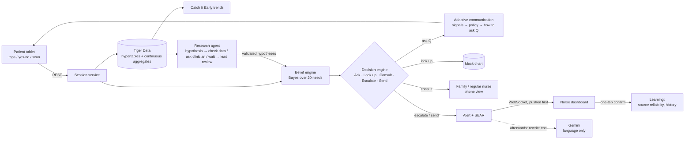

# MediCue

MediCue turns a few taps from a patient who can't speak into a precise, structured clinical message, and
says how certain it is. Behind the interface, a decision engine picks the best next move each time: ask the
patient a yes/no question, look up their chart, consult someone who knows them, or escalate to a nurse now.
The **Adaptive Communication Engine** decides how to ask: when answering gets harder, the tablet simplifies
itself (fewer, bigger choices, then one yes/no question at a time, then someone to help) without losing anything
the patient has said. See [docs/ADAPTIVE_COMMUNICATION.md](docs/ADAPTIVE_COMMUNICATION.md).

Built for Hack the Valley. **Prototype with synthetic patient data. A communication aid, not a diagnostic device.**

## Quick start

```bash
# backend (terminal 1)
cd backend && python3 -m venv .venv && .venv/bin/pip install -r requirements.txt
.venv/bin/uvicorn app.main:app --reload

# frontend (terminal 2)
cd frontend && npm install && npm run dev       # open http://localhost:3000
```

Sign in with a demo account (the login page has one-tap buttons for them): nurse `nurse@medicue.demo` / `nurse`,
patient `patient@medicue.demo` / `patient`. Set `DEMO_NURSE_PASSWORD` / `DEMO_PATIENT_PASSWORD` to change them.

No database or API key is needed: it falls back to an in-memory store and template text.
Set `DATABASE_URL` (Tiger Data) and `GEMINI_API_KEY` to turn those on (see `backend/.env.example`).
Full stack in Docker: `cd infra && cp .env.example .env && docker compose up --build`, then open http://localhost:8000.

## How it works



- **Belief engine** (`backend/app/engine/belief.py`): prior from time of day, surgery recency, the patient's
  confirmed history and validated findings. Bayes update on every tap, answer, chart lookup and caregiver answer.
  Each source has a learned Beta reliability.
- **Decision engine** (`backend/app/engine/decision.py`):
  `score(a) = E[Δ expected loss] + μ·κ(b)·EIG(a) − λ_F·fatigue(a) − λ_D·delay(a)·risk(b)`, with an asymmetric loss
  (missing chest pain costs 12.5× confusing thirst with cold).
- **Safety floor**: if P(any high-risk need) ≥ 25%, it escalates at once. This rule is deterministic and works
  offline, and chart data can't override a patient's own signal. Full list in `backend/README.md`.
- **Adaptive communication** (`backend/app/engine/communication/`): signal detection (slowdown against this session's
  or the patient's own baseline, corrections, uncertainty, silence) → a deterministic policy (Standard → Simplified →
  Yes / No → Assisted, plus bigger targets, confirmation, simpler wording, read aloud, language) → the tablet renders it.
  Escalation always comes first; Gemini only rewords and translates, validated, with catalog fallbacks.
- **Calibrated output**: split conformal prediction gives the smallest set of needs containing the true one 90% of the time.

Synthetic evaluation (`python -m app.sim.evaluate`): on scripted scenarios, 96% top-1 accuracy, 100% of high-risk
cases escalated with no question, 2.9 patient inputs per need, and 70% fewer questions than a fixed 3-question
tree. On a noisy population, conformal coverage is 92%. These numbers come from simulated patients, not clinical validation.

## Repository and branches

| Path | Owner branch | Contents |
|---|---|---|
| `shared/` | `shared` | Need catalog, tap vocabulary, chart lookups (`catalog.json`), API types (`types.ts`) |
| `backend/` | `backend` | FastAPI, engines, sessions, trends, research, stores, simulator, tests |
| `frontend/` | `frontend` | React + Vite: patient tablet, nurse dashboard, family view, research review |
| `infra/`, `.github/` | `infra` | Docker Compose (TimescaleDB), Vultr + domain deploy, Caddy TLS, CI |

**Workflow**

```
feature/xyz ──► backend | frontend | shared | infra ──► dev ──► main
```

- `main`: always demo-able. Only merge `dev` into it after the demo path works end to end.
- `dev`: integration. Area branches merge here; CI runs here and on PRs.
- `shared`: change the contract here first (catalog or `types.ts`), then merge `shared` into `backend` and `frontend`.
- `backend`, `frontend`, `infra`: each area's working branch. Branch `feature/<name>` off one for anything bigger than a fix.
- Suggested later branches: `feature/gemini-notes` (free-text chart notes → lookup flags),
  `feature/eye-gaze` (stretch goal), `feature/tiger-dashboards`.

## Prize-track coverage (first iteration)

| Track | Where | Status |
|---|---|---|
| PointClickCare: Catch It Early | `#/nurse` right column; `services/trends.py`; hourly continuous aggregate | ✅ Per-patient 24 h vs 7-day baseline: pain, high-risk, seconds/tap, taps/need, scan-mode share, chart-event annotations |
| MLH Gemini | `services/gemini.py` | ✅ SBAR, translation of tiles/questions (7 languages), caregiver question wording, research hypotheses. Escalation never depends on it |
| MLH Tiger Data | `store/schema.sql`, `store/timescale.py` | ✅ Hypertables for events, belief snapshots and confirmations; `patient_hourly_signals` and `communication_hourly` continuous aggregates, re-windowed with `time_bucket` SQL. Needs a Tiger service URL |
| AI for Social Impact | patient tablet | ✅ Grid, large-tile and single-switch scanning modes, auto-switch to large tiles on fatigue, speech output, translated UI. Patient intent is never overwritten by chart data |
| Healthcare & Well-being | whole app | ✅ No clinical-efficacy claims; disclaimers in the UI |
| MLH Vultr | `infra/deploy/vultr.md`, `setup-vultr.sh` | 🟡 Scripts ready; needs an instance |
| Papiers Autoresearch | `#/research`, `engine/research_decision.py`, `services/research*.py` | ✅ Clinician observations and detected patterns become hypotheses. An agent picks CHECK_DATA / ASK_CLINICIAN / WAIT by information gain − cost (scores shown), updates confidence, and sends hypotheses to mandatory lead review. Validated ones change priors; rejected ones stay rejected |
| GoDaddy Registry domain | `infra/deploy/Caddyfile` | 🟡 Needs a registered domain + A record |
| KAZE (conditional) | family view → "Check on …"; `start_welfare` | 🟡 Minimal: a pre-authorised caregiver asks for a check-in; no response in time → urgent nurse alert. Explicitly *not* unconsciousness detection |

## Demo script (≈3 min)

1. Open `#/nurse` on a laptop and `#/patient/p-chen` on a tablet, with "Show engine" on.
2. **Emergency**: tap *Chest*. The nurse gets an urgent alert within a second, with no questions asked. Then tap
   *Hurts*: the open alert refines in place.
3. **Routine with clarification**: start again, tap *Washroom → Need to go*. The engine weighs asking against
   consulting Lin. Open `#/family/fam-lin` and answer. One confirming question follows, then a routine SBAR alert.
   Confirm it on the nurse screen in one tap.
4. **Catch It Early**: Wei Chen's pain requests jumped after a gabapentin reduction. Rosa Alvarez is taking longer per tap and moving to switch scanning.
5. **Research agent**: Priya's observation "Mr. Chen seems more anxious after his daughter leaves" is already a
   hypothesis. Open its timeline and decision trace: the agent checked the data first (0.50 → 0.87), then chose to ask
   Marcus rather than Priya. Answer **Agree** as Marcus. It crosses 0.90 and moves to Pending review, where you
   **Validate** it. Then type a new observation and watch the agent pick its first action.
6. **Accessibility**: on `#/patient/p-alvarez`, switch to *Switch scanning* and select with the space bar.
