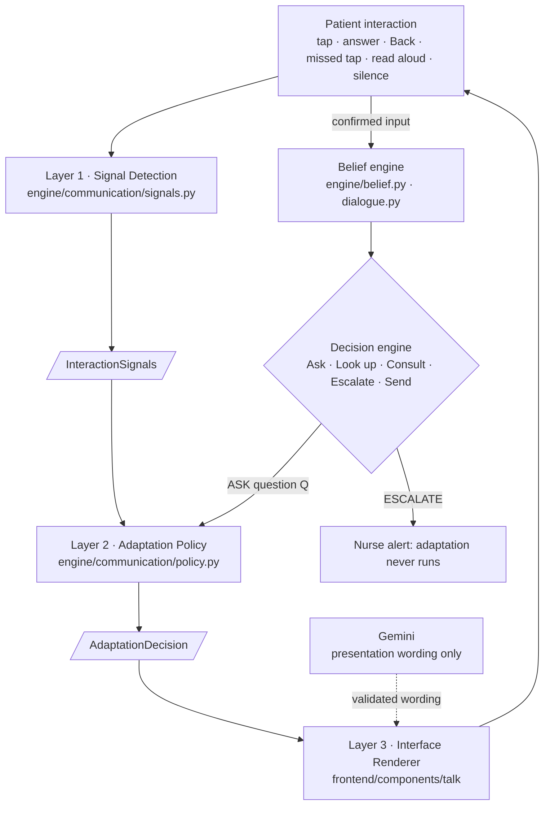

# MediCue Adaptive Communication Engine

MediCue's decision engine decides **what** to ask a patient who can't speak. The Adaptive Communication Engine
decides **how** to ask it, and changes that while the conversation is going: fewer and bigger choices when
answering slows down, a confirmation step when taps keep going astray, simpler words when the patient keeps
answering "not sure", one yes/no question at a time, read aloud, or someone to help. The tablet is English only.

It never changes what an answer means. Switching how a question is asked keeps the same session, the same belief,
the same confirmed answers and the same urgency.

## Why it exists

The patients MediCue is for (after a stroke, with ALS, intubated or after surgery, with motor or visual limits)
often start a conversation able to use the full screen and then tire, or slip, or can't find
the word. A fixed interface fails them exactly then. A person at the bedside would notice and simplify. MediCue
does the same, and tells the nurse why.

## Three layers



| Layer | Where | Responsibility | Never |
|---|---|---|---|
| 1 · Signal Detection | `backend/app/engine/communication/signals.py` | Measures what happened: latency, slowdown, corrections, uncertainty, missed taps and responses, read-aloud use, fatigue | Decides anything |
| 2 · Adaptation Policy | `backend/app/engine/communication/policy.py` | Decides whether to change and the least disruptive change | Renders, touches the belief, or runs while escalating |
| 3 · Interface Renderer | `frontend/components/talk/*`, `frontend/lib/live/talk-adapter.ts` | Draws the decided mode: choices shown, button size, spacing, wording, confirmation, read aloud | Decides to adapt |

Both backend layers are pure (no I/O, no clock, no network) and deterministic: the same interactions give the same
decision. `backend/app/services/communication.py` connects them to a live session: it records each interaction,
runs the two layers, applies the decision, logs events and sends the tablet its `communication` state.

## Signals collected (layer 1)

`InteractionSignals`: latest and recent response latency, the baseline it's compared with and where that baseline
comes from, `slowdown_ratio`, how many recent responses were slow and whether that's sustained, corrections (Back,
"Change" on a confirmation), missed taps, "not sure" / "none of these", answers the belief found unexpected,
missed responses (silence for half the silence timeout), read-aloud presses, longest silence, a good-response
streak, the dialogue's fatigue score and recent mode changes.

Counts cover only the window since the last adaptation, so each change is judged on what happened after it.

## What is never inferred

- **Visual impairment**: missed taps never turn on audio. Read aloud comes from the patient's own use of it
  (offered after two presses), their choice, or their saved accessibility setting.
- **Cognition, deterioration, diagnosis**: nothing here says anything about the patient. The nurse view says
  "communication effort has increased", never "cognition is declining".
- **Speech failure**: MediCue has no speech input, so there is nothing to detect; switching input methods would
  not reset anything if it were added.

## Baselines: cold start to personalized

| Status | When | Slowdown is measured against |
|---|---|---|
| `COLD_START` | no history | this session's first 3 responses (median) |
| `LEARNING` | 1-4 past sessions | this session's baseline, or the history until there is one |
| `PERSONALIZED` | 5+ past sessions | the patient's usual seconds per input (median over past sessions) **and** this session's baseline |

`slowdown_ratio = median(last 2 responses) / baseline`. A response counts as slow at 1.8× the baseline. One slow
response is an outlier and changes nothing; a slowdown needs both recent responses to be slow, or one slow response
plus another sign of difficulty (a correction, a missed tap, uncertainty). When both baselines exist the stronger
evidence is used and reported with its source, so the nurse sees "2.3× this session's baseline" or "2.1× their
usual". The patient's history comes from the `confirmations` hypertable (`mean_tap_interval`). All thresholds are
in `SignalConfig` / `PolicyConfig`.

## Modes and modifiers

| Mode | Shows | Severity |
|---|---|---|
| 1 · STANDARD | Body map, then up to 4 tailored choices | 0 |
| 2 · SIMPLIFIED | The 3 likeliest areas, then 2 larger choices, shorter wording, more spacing | 2 |
| 3 · BINARY | One huge Yes / No / Not sure question at a time, read aloud | 3 |
| 4 · ASSISTED | Confirmed and unresolved information, someone helping; the question stays answerable | 4 |

Modifiers combine with any mode: `large_targets`, `extra_spacing`, `confirm_selections` ("You selected Chest
pressure. Is that right? Yes / Change"), `simple_wording` (severity 1), `audio`.

High-risk choices (chest, breathing, choking) are always on screen, at every mode. In BINARY, a patient who hasn't
tapped a feeling is first asked "Chest or breathing?", because the body map would have caught that in one tap.

## Policy rules (first match wins)

0. The decision engine is escalating: no adaptation. Escalation always comes first.
1. In BINARY and still struggling (a missed response, 2 uncertain answers, 2 slips, or a sustained slowdown):
   **offer** help communicating: *Get nurse · Ask someone I know · Keep trying*.
2. 2 missed responses in any mode: offer help communicating.
3. A missed response: one step simpler.
4. Sustained slowdown, or one slow response plus another difficulty: one step simpler
   (STANDARD → SIMPLIFIED → BINARY). *"I've simplified the choices."*
5. 2 corrections or missed taps: bigger, spaced-out targets with confirmation; if already on, fewer choices.
   *"I'll make the choices easier to select."*
6. 2 "not sure" or unexpected answers: simpler wording; if already simple, one yes/no question at a time.
   *"Let me ask that more simply."*
7. Read aloud pressed twice: **offer** audio-first.
8. 2 good responses in a row: one step back up, never past a mode someone chose by hand.

Small presentation changes apply automatically, with a short neutral message. Bigger changes of channel (help
communicating, audio-first) are offered and wait for the patient's yes. "Make it easier" / "More choices" and read
aloud are always available to the patient and to a nurse.

## Preserving patient intent

A mode change never creates a session, resets the belief, discards confirmed answers or chart context, resets
fatigue, changes urgency or re-asks a confirmed question. Every mode feeds the same evidence:

- BINARY asks the area's tailored options one at a time ("Hurts or pressure?"); a *yes* is exactly that option's
  tap. Then the decision engine's own yes/no questions, at the same likelihoods.
- The same catalog question has a standard, simplified and yes/no form (`shared/catalog.json`: `question`,
  `short`); only the text changes.
- "Not sure" stays uncertainty at every level and is never read as "no". Unresolved items are shown as unresolved.
- Going Back removes the undone answer from the interaction log, then counts the Back as a correction.
- A mode change never restarts the silence timer, so silence is escalated on time (sooner in ASSISTED).

## Gemini's role

`backend/app/services/communication_language.py` (`CommunicationLanguageService`) is the only source of on-screen
text.

- `Gemini.simplify_questions()` receives structured items (`id`, `semantic_intent`, `original_text`,
  `target_complexity`, `allowed_answers`, `max_words`) for every question, prompt and option label: one request
  for "simple" and one for "binary", at startup, cached. Each returned string is validated: not empty, within the
  word limit, still a question, and **no clinical term (body part, symptom, need) that the original or its intent
  didn't contain**. A rejected string keeps the deterministic wording.
- `Gemini.level_explanation()` writes an optional one-line note for the nurse after a change.

Gemini never decides to adapt, never chooses answer options, never changes a probability, an id or escalation,
and never infers a disability.

**Fallback**: with no key, a failure or an exhausted quota, the catalog's own wording is used (`question` for
standard and simplified, `short` for yes/no).

## Events (Tiger Data)

Written to the `events` hypertable with the patient and session ids:

| Event | When |
|---|---|
| `communication_difficulty_detected` | the policy wants to adapt (with signals and decision) |
| `communication_mode_changed` | mode changes (from/to, reason, severity, slowdown ratio, fatigue, signals, renderer before/after) |
| `communication_presentation_changed` | modifiers change |
| `question_simplified` | simpler wording or yes/no because of uncertainty |
| `audio_mode_enabled` | read aloud turned on by the patient's choice |
| `answer_corrected` | Back, or "Change" on a confirmation |
| `interaction_unresolved` | a missed response mid-request |
| `communication_offer`, `communication_offer_answered` | offers and the patient's answer |
| `assisted_communication_started` | help communicating begins, with the confirmed / unresolved summary |

## Longitudinal trends (PointClickCare: Catch It Early)

Unit insights → "Is communicating getting harder for anyone?" adds, per patient, this week vs the week before
(`services/nurse_views.py`, from the events above): share of sessions that needed a simpler screen, share that
needed yes/no, help-communicating episodes and read-aloud use. Amber at 15%+ and 10 points over
last week, red at 30%+ and 20 points over: *"Communication effort has increased compared with recent
interactions."* The 14-day unit history runs the same policy over each simulated session's taps
(`data/unit_history.py`), so these numbers are computed, never placed.

## Nurse station

- **Patients page**: each patient's current communication mode and how many times it changed this shift
  (`GET /api/communication`, which also returns the reason in numbers, the screen change and the three-layer
  trace for each change).
- **"Needs help communicating" requests** in the queue: what is confirmed, what is unresolved and the current
  belief.
- **Unit insights**: the "Simpler screens needed (7 d)" trend above.

## Accessibility principles

- Urgent help is one tap away in every mode; adaptation never blocks it.
- Neutral wording: it is the screen that changes, never a judgement about the patient.
- Every change is reversible by the patient ("More choices") or a nurse.
- Visual alternatives stay when audio is on; keyboard numbers and R (repeat) work in audio mode.
- Colour is never the only signal; motion is short and calm.

## Try it

```bash
cd backend && .venv/bin/python -m app.sim.communication_demo all    # backend running on :8000
```

Open `/talk/p-chen`, `/talk/p-patel` and `/nurse` first. Scenarios: **A** slowdown (2.4, 2.7, 2.6, 5.8, 6.4 s →
Simplified on the last), **B** repeated "not sure" (simpler wording, then yes/no), **C** corrections, slowdown,
silence in yes/no → help communicating → "Get nurse" with confirmed information preserved. Sign in as the patient
to watch the tablet (nurses can't open it).

Tests: `backend/tests/test_communication.py` (layers tested separately and together).
